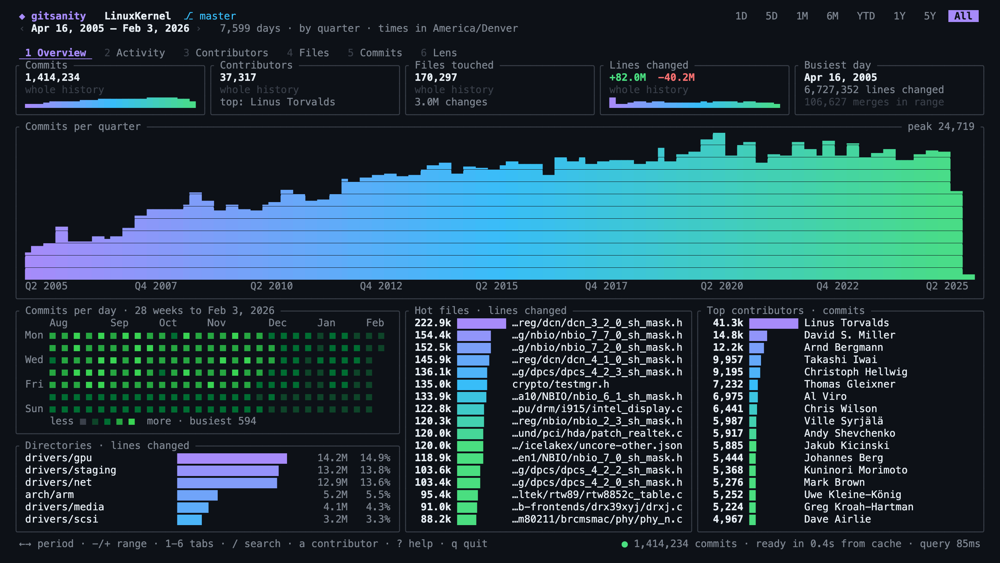
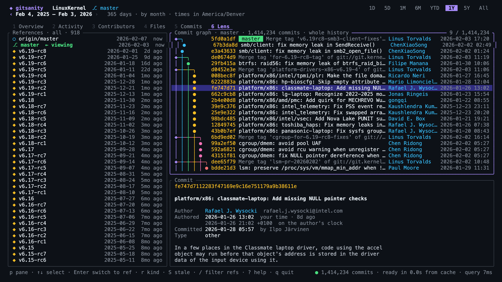

# gitsanity

Git history analytics for the terminal. The Rust successor to the Gitsanity
macOS app: open a repository, get commits, contributors, hot files, code
frequency and work rhythm for any time range, without waiting.





## Install

Homebrew (macOS or Linux):

```bash
brew install danielwanja/tap/gitsanity
```

Without Homebrew, the installer picks the right binary, verifies its checksum
and puts it in `~/.local/bin` (no `sudo`, no Rust needed):

```bash
curl --proto '=https' --tlsv1.2 -LsSf https://github.com/danielwanja/gitsanity/releases/latest/download/gitsanity-installer.sh | sh
```

With Rust 1.88 or newer:

```bash
cargo install --git https://github.com/danielwanja/gitsanity
```

Prebuilt archives for macOS (Apple Silicon, Intel) and Linux (x86-64, arm64)
are on the [Releases](https://github.com/danielwanja/gitsanity/releases) page.

## Status: 2.0 alpha

| View | What it shows |
| --- | --- |
| Overview | Totals with change against the previous period, commits over time, day grid, hot files, top contributors |
| Activity | Lines added and removed over time, largest commits, commit types, file-change kinds, work rhythm |
| Contributors | Everyone active in the range, with a side panel for the selected person |
| Files | Hot files, directories, file types |
| Commits | Searchable list with full detail: both clocks, message body, files |
| Lens | Branches, tags and remotes; the commit graph; switch the analysis to another ref |

Everything follows the time range, and can be narrowed to one contributor
(`a`) or one file or folder (`Enter` on a file, `u` to widen). When the ref
moves (commit, pull, rebase) the open app re-reads the history by itself.

```bash
gitsanity                      # the repository you are in
gitsanity ~/code/some-repo
gitsanity --ref v1.2           # a branch or tag instead of HEAD
gitsanity --tz Europe/Zurich   # show dates in another time zone
```

Press `?` in the app for the keys.

Not ported from the macOS app yet: staleness and new-file tables, storage
treemap, repo hygiene, report export, content-similarity rename detection
(only exact renames are paired), mailmap. A moved ref triggers a full re-index
rather than an incremental one. SHA-256 repositories are not supported.

## How it is fast

History is read straight from the object database with
[gitoxide](https://github.com/GitoxideLabs/gitoxide), on all cores, in three
passes the UI can show one at a time:

1. commits (parallel graph walk)
2. files touched per commit (parallel tree diff)
3. lines added / removed per file (parallel blob diff, Myers, like `git log --numstat`)

The result is a set of plain in-memory columns sorted by time, so a time
window is an index range and every screen is one linear scan. It is saved
compressed under the user cache directory and reloaded when HEAD is unchanged.

Measured on a 14-core Apple Silicon Mac (`gitsanity bench <repo> --cache`):

| Repository | Commits | First screen | Files known | Fully indexed | Reopen from cache |
| --- | ---: | ---: | ---: | ---: | ---: |
| Linux kernel | 1,414,234 | 2.1 s | 9.8 s | 50.9 s | 0.33 s |
| swift | 197,206 | 0.3 s | 1.6 s | 10.1 s | |
| VS Code | 145,304 | 0.2 s | 1.0 s | 4.8 s | |
| rails | 97,074 | 0.1 s | 0.4 s | 1.7 s | 0.02 s |

Dashboard recompute on the kernel: 81 ms for all 21 years, 7 ms for one year.

## Dates

Timestamps are stored as epoch seconds. Days, months, weekdays, hours and
every range label are derived in the viewer's time zone at query time
(`--tz Europe/Zurich` overrides the system zone). Windows are whole local days,
half-open, and tile exactly when stepping. An author date that is later than
its own commit, or earlier than the repository's first commit, is treated as a
broken clock and replaced by the commit date. See `src/time.rs` and its tests.

## Develop

```bash
cargo test
cargo run --release -- bench <repo> --cache
cargo run --release -- snapshot <repo> --tab activity --range 1Y            # text
cargo run --release -- snapshot <repo> --tab overview --html overview.html  # with colours
```

## Releasing

Releases are built by [`cargo-dist`](https://github.com/axodotdev/cargo-dist)
in GitHub Actions ([`release.yml`](.github/workflows/release.yml)). Bump the
version in `Cargo.toml`, commit, then push a matching tag:

```bash
git tag v2.0.0-alpha.1 && git push origin v2.0.0-alpha.1
```

That publishes the GitHub Release and updates the formula in
[`danielwanja/homebrew-tap`](https://github.com/danielwanja/homebrew-tap).
The workflow needs the `HOMEBREW_TAP_TOKEN` repository secret (a token that
can push to the tap).

## License

MIT, see [LICENSE](LICENSE).
